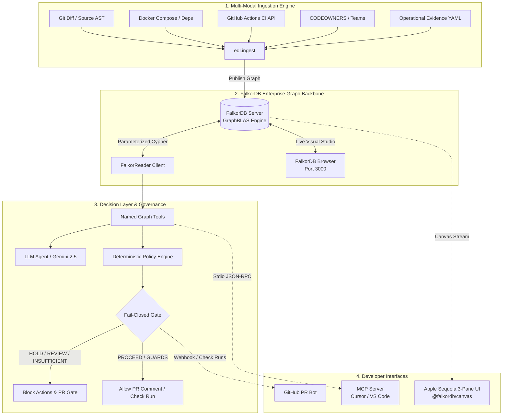
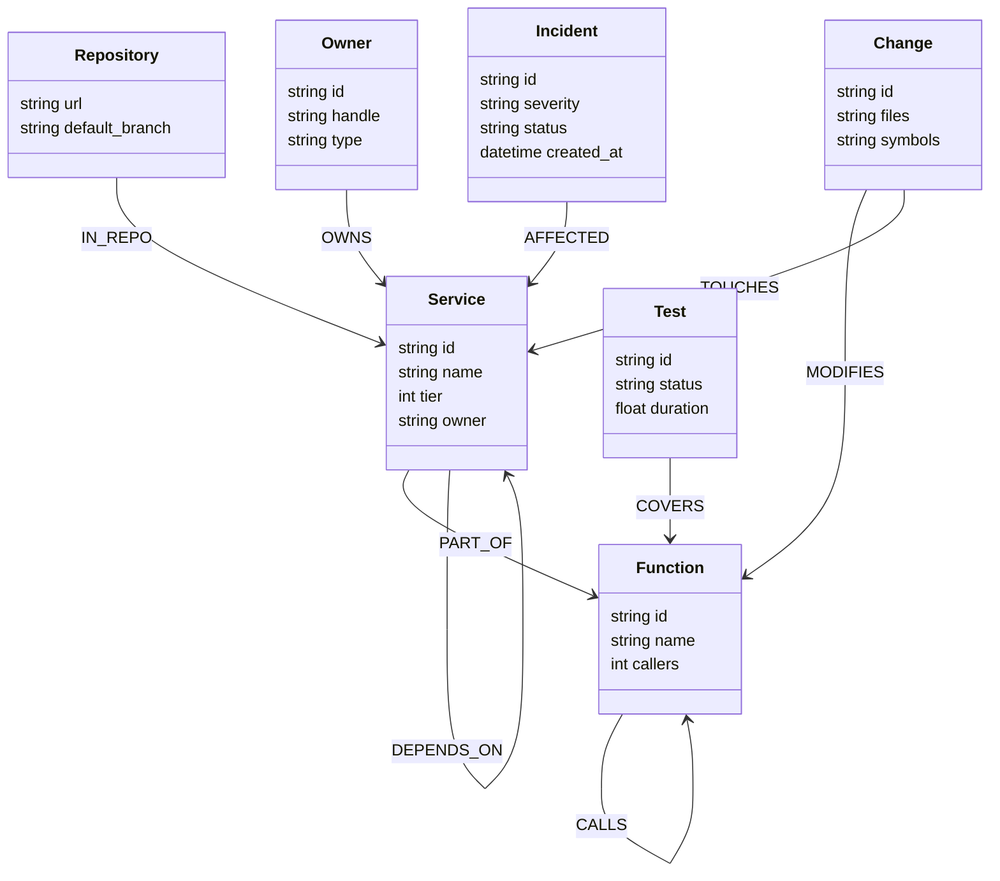

# Syzygy EDL · Engineering Decision Layer

<div align="center">

[](https://www.falkordb.com/)
[](https://www.falkordb.com/)
[](https://github.com/FalkorDB/canvas)
[](https://modelcontextprotocol.io/)
[](https://aistudio.google.com/)
[](https://python.org)
[](LICENSE)

**An autonomous, graph-backed change verification platform powered by FalkorDB.**  
*Bridges the gap between raw AST code diffs and enterprise runtime reality through graph topology, deterministic policy gating, and multi-hop blast radius analysis.*

[Live FalkorDB Studio](http://13.236.193.238:3000) • [Architecture](#system-architecture) • [FalkorDB Ecosystem](#falkordb-ecosystem-deep-dive) • [3-Pane Workbench UI](#apple-macos-sequoia-3-pane-workbench-ui) • [Ablation Benchmark](#empirical-benchmarks--3-way-mode-ablation) • [Quickstart](#2-minute-quickstart) • [MCP Setup](#model-context-protocol-mcp-integration)

</div>

---

## Table of Contents
- [Executive Summary & Core Thesis](#executive-summary--core-thesis)
- [System Architecture](#system-architecture)
- [FalkorDB Ecosystem Deep-Dive](#falkordb-ecosystem-deep-dive)
  - [1. FalkorDB Server & GraphBLAS Engine](#1-falkordb-server--graphblas-engine)
  - [2. Official `@falkordb/canvas` (v0.0.29) UI Integration](#2-official-falkordbcanvas-v0029-ui-integration)
  - [3. Enterprise Knowledge Graph Schema](#3-enterprise-knowledge-graph-schema)
  - [4. FalkorDB Browser / Graph Studio](#4-falkordb-browser--graph-studio)
- [Apple macOS Sequoia 3-Pane Workbench UI](#apple-macos-sequoia-3-pane-workbench-ui)
- [Empirical Benchmarks & 3-Way Mode Ablation](#empirical-benchmarks--3-way-mode-ablation)
  - [Ablation Matrix: Proving "Graph Lift"](#ablation-matrix-proving-graph-lift)
  - [Why Naive LLMs Catastrophically Fail](#why-naive-llms-catastrophically-fail)
- [Security: Named Graph Tools vs Free Cypher](#security-named-graph-tools-vs-free-cypher)
- [Deterministic Policy Engine & Fail-Closed Gate](#deterministic-policy-engine--fail-closed-gate)
- [2-Minute Quickstart](#2-minute-quickstart)
  - [Installation (Windows / macOS / Linux)](#installation-windows--macos--linux)
  - [Running the Product](#running-the-product)
- [Model Context Protocol (MCP) Integration](#model-context-protocol-mcp-integration)
- [GitHub Actions & Pull Request Automation](#github-actions--pull-request-automation)
- [Deployment Guide](#deployment-guide)

---

## Executive Summary & Core Thesis

### The Fatal Flaw of "Diff-Only" AI Code Review
Modern AI code-review bots evaluate pull requests in a vacuum. Given a code patch, an LLM inspects the immediate lines of diff and predicts whether the change "looks safe." This creates a dangerous illusion of security:
1. **Blind to Multi-Hop Blast Radius**: A 2-line function change in an internal utility service can propagate transitively across 3 hops into tier-0 billing pipelines. Diff-only tools cannot compute this dependency closure.
2. **Ignorant of Production Realities**: A diff does not reveal whether the modified service is currently recovering from a SEV-1 outage or whether CI test runs are stale (>24 hours old).
3. **Hallucinatory Approvals**: Unconstrained LLMs suffer from positive approval bias. When crucial context is missing, baseline LLMs hallucinate a `PROCEED` verdict rather than abstaining.

### The Syzygy EDL Solution
**Syzygy EDL (Engineering Decision Layer)** transforms code change governance from speculative LLM text prediction into **verifiable graph topology traversal on FalkorDB**:
- **Code + Runtime Ingestion**: Ingests code ASTs, call graphs, Docker Compose topology, GitHub Actions CI runs, and CODEOWNERS files directly into **FalkorDB**.
- **Bounded Tool Layer**: Autonomous agents never execute unconstrained, free-text Cypher. They interface through 10 strictly typed, parameterized graph tools (e.g. `impact_analysis`, `centrality_rank`, `find_similar_incidents`).
- **Deterministic Policy Gate**: Decisions are governed by hard enterprise policies (`policies/policies.yaml`). The agent narrates reasoning, but the **policy engine strictly dictates the state**: `PROCEED`, `PROCEED_WITH_GUARDS`, `NEEDS_REVIEW`, `HOLD`, or `INSUFFICIENT_EVIDENCE`.
- **Fail-Closed Safety**: If telemetry is stale, missing, or inconclusive, the gate **fails closed** (`INSUFFICIENT_EVIDENCE`), actively blocking deployments and issue creation.

```
┌─────────────────┐       ┌────────────────────────┐       ┌─────────────────────────┐
│ Git / CI / Ast  │ ───▶  │      FALKORDB          │ ───▶  │ DETERMINISTIC POLICY    │
│ Raw Repositories│       │ Knowledge Graph Engine │       │ Fail-Closed Action Gate │
└─────────────────┘       └────────────────────────┘       └─────────────────────────┘
                                       │                                │
                                       ▼                                ▼
                          ┌────────────────────────┐       ┌─────────────────────────┐
                          │ @falkordb/canvas       │       │ Verified Decision Card  │
                          │ 3-Pane Workbench UI    │       │ PR Block / Allow Token  │
                          └────────────────────────┘       └─────────────────────────┘
```

---

## System Architecture

Syzygy EDL operates across three coordinated layers:



---

## FalkorDB Ecosystem Deep-Dive

Syzygy EDL is purpose-built to leverage the complete **FalkorDB** ecosystem at production depth:

### 1. FalkorDB Server & GraphBLAS Engine
FalkorDB is a low-latency, high-throughput graph database built on Redis and powered by **GraphBLAS** (sparse linear algebra matrix multiplication algorithms).
- **Sub-Millisecond Traversal**: Multi-hop reachability walks (`DEPENDS_ON*1..3`) and caller hubs (`CALLS`) run in sub-millisecond time across complex microservice graphs.
- **Fail-Closed Graph Enforceability**: If FalkorDB is offline or unpopulated, Syzygy EDL refuses to invent decisions from volatile in-memory fallbacks, failing closed with `INSUFFICIENT_EVIDENCE`.
- **Primary Connection Handle**: Connects directly via Redis protocol on `13.236.193.238:6379` using the official `falkordb==1.1.2` driver with parameterized Cypher queries.

### 2. Official `@falkordb/canvas` (v0.0.29) UI Integration
Rather than using generic D3 or Vis.js canvas renderers, Syzygy EDL integrates the official `@falkordb/canvas` library (`web/vendor/falkordb-canvas.js`):
- **Custom Web Component (`<falkordb-canvas>`)**: Embedded seamlessly into our center stage layout.
- **Hardware-Accelerated WebGL/Canvas Physics**: Smooth 60fps force-directed simulations with dynamic node dragging, collision avoidance, and viewport camera manipulation (Zoom In/Out, Fit-to-Viewport).
- **Arched Bezier Edges**: Custom bidirectional curve routing prevents edge collisions and clarifies circular dependency loops.
- **Custom Graph Theming**: Color palettes mapped directly to engineering node classes with high-contrast active highlights and hover states.

### 3. Enterprise Knowledge Graph Schema
The graph ontology models 14 distinct node labels and 16 directional relationship types:



#### Node Labels (14):
`Repository`, `Team`, `Engineer`, `Service`, `Function`, `Test`, `Deployment`, `Incident`, `Fix`, `Policy`, `Change`, `UnresolvedPath`, `DecisionRecord`, `EvidenceSource`.

#### Relationship Types (16):
`DEPENDS_ON`, `CALLS`, `COVERS`, `OWNS`, `AFFECTED`, `RESOLVED_BY`, `DEPLOYED_AS`, `MEMBER_OF`, `IN_REPO`, `PART_OF`, `MODIFIES`, `TOUCHES`, `UNRESOLVED`, `DECIDES`, `SUPPORTED_BY`, `GOVERNS`.

### 4. FalkorDB Browser / Graph Studio
Syzygy EDL connects directly to the official **FalkorDB Browser Studio** at:
👉 **`http://13.236.193.238:3000`** (Graph: `edl` / `Test`)
- Inspect raw Cypher execution in real time.
- Verify nodes, edge indices, and schema constraints live during hackathon judging.

---

## Apple macOS Sequoia 3-Pane Workbench UI

The frontend (`web/index.html`, `web/styles.css`, `web/app.js`) has been meticulously designed following the **Apple Human Interface Guidelines (HIG)** and macOS Sequoia design system:

```
┌─────────────────────────┬───────────────────────────────────────────────┬─────────────────────────┐
│  PANE 1: RAIL (Steps)   │           PANE 2: STAGE (FalkorDB)            │  PANE 3: TELEMETRY      │
├─────────────────────────┼───────────────────────────────────────────────┼─────────────────────────┤
│ [1] ANALYZE             │ [❚❚] [⊡] [+] [-]   [Force] [Radial] [Tree]    │ ┌ Claims ─────────────┐ │
│   Repo Picker / OAuth   │ ┌───────────────────────────────────────────┐ │ │ Symbol assertions   │ │
│                         │ │                                           │ │ ├ Evidence ───────────┤ │
│ [2] SCOPE               │ │      <falkordb-canvas>                    │ │ │ Verified CI & Ops   │ │
│   Files & Symbols       │ │      Interactive Multi-Hop Graph          │ │ ├ Tools Trace ────────┤ │
│                         │ │                                           │ │ │ Exact Cypher tools  │ │
│ [3] DECIDE              │ └───────────────────────────────────────────┘ │ ├ Missing ────────────┤ │
│   [Review] [Agent] [+LLM│  [x] Changed  [o] Function  [◇] Service       │ │ Gaps forcing abstain│ │
│   VERDICT: [HOLD]       │  [!] Incident [★] Owner     [✓] Test          │ └─────────────────────┘ │
└─────────────────────────┴───────────────────────────────────────────────┴─────────────────────────┘
```

### 1. Left Rail (Navigation & Decision Gate)
- **Step 1: Repository Ingestion**: Connect GitHub via OAuth 2.0, search active repositories, or analyze local paths.
- **Step 2: Change Scope**: Automated symbol extraction and AST parsing identifying modified functions and affected blast radius.
- **Step 3: Decision Path**: Toggle between deterministic `Review`, heuristic `Agent`, and multimodal `+ LLM` (Google Gemini 2.5 / 3.8 Flash).
- **Decision Gate Card**: Displays the live verdict badge (`HOLD`, `PROCEED_WITH_GUARDS`, `NEEDS_REVIEW`, `PROCEED`, `INSUFFICIENT_EVIDENCE`), the **Graph Lift** metric kicker, active policy IDs, required next steps, and action triggers (Create Issue, Notify Team, Post to GitHub PR).

### 2. Center Stage (`<falkordb-canvas>` Knowledge Graph)
- **Dynamic Camera & Physics Toolbar**: Pause/Resume layout physics, Zoom In/Out, Fit-to-Screen.
- **3 Native Layout Engines**:
  - **Force-Directed**: Elastic spring simulation showcasing natural microservice clusters.
  - **Concentric Radial**: Places the modified root function at the center, radiating outwards by dependency hops.
  - **Hierarchical Tree (LR)**: Clean left-to-right DAG showing upstream services flowing to downstream consumers.
- **Sliding Node Property Inspector**: Click any node to slide open its live properties (callers, open incidents, ownership handles, test coverage percentage).
- **6-Class Swatch Legend**: Visual semantic cues for Changed (Red), Function (Blue), Service (Indigo), Incident (Amber), Owner (Teal), Test (Emerald).

### 3. Real-Time Telemetry & Evidence Strip
- **Claims**: Scoped assertions and boundary conditions evaluated for the change.
- **Evidence**: Concrete facts proven with timestamps, freshness status, and source signatures.
- **Tools Trace**: Real-time log of every named FalkorDB tool executed by the agent.
- **Missing Evidence**: Explicitly flags what is missing (e.g. `CI run older than 24h`), triggering the fail-closed policy.

---

## Empirical Benchmarks & 3-Way Mode Ablation

To empirically prove that graph database topology is strictly necessary for software safety, Syzygy EDL includes an automated evaluation harness (`python -m edl eval`) testing 6 production scenarios across 3 ablation modes:

### Ablation Matrix: Proving "Graph Lift"

| Evaluation Scenario | Scenario Family | Expected Verdict | Full Graph (Syzygy) | 1-Hop Only | Graph Off | Baseline Naive LLM | Graph Lift Proven? |
|---|---|---|:---:|:---:|:---:|:---:|:---:|
| **Missing CI Run** | Uncertain | `INSUFFICIENT_EVIDENCE` | **OK** (`INSUFFICIENT`) | **OK** (`INSUFFICIENT`) | **OK** (`INSUFFICIENT`) | ❌ `PROCEED` *(Hallucinated)* | **Abstention Preserved** |
| **Tier-0 Incident (2 Hops)** | Risky | `HOLD` | **OK** (`HOLD`) | ❌ `PROCEED` | ❌ `PROCEED` | ❌ `PROCEED` *(Catastrophic)* | 🏆 **YES (Graph Lift)** |
| **Graph Adds Nothing (Stale CI)** | Uncertain | `INSUFFICIENT_EVIDENCE` | **OK** (`INSUFFICIENT`) | **OK** (`INSUFFICIENT`) | **OK** (`INSUFFICIENT`) | ❌ `PROCEED_WITH_GUARDS` | **Abstention Preserved** |
| **Complete Evidence Base** | Safe | `PROCEED` | **OK** (`PROCEED`) | **OK** (`PROCEED`) | **OK** (`PROCEED`) | **OK** (`PROCEED`) | **Parity** |
| **Payment Path (No Approval)** | Risky | `NEEDS_REVIEW` | **OK** (`NEEDS_REVIEW`) | **OK** (`NEEDS_REVIEW`) | **OK** (`NEEDS_REVIEW`) | ❌ `PROCEED` *(Bypassed Auth)* | **Policy Guarded** |
| **Multi-Owner Split (3 Hops)** | Risky | `NEEDS_REVIEW` | **OK** (`NEEDS_REVIEW`) | **OK** (`NEEDS_REVIEW`) | ❌ `PROCEED` | ❌ `PROCEED` *(Ignored Owner)* | 🏆 **YES (Graph Lift)** |

### Benchmark Results (`python -m edl eval`)
```
## Summary
  full       accuracy=6/6 (100%)  unjustified_proceed=0
  one_hop    accuracy=4/6 (66%)   unjustified_proceed=1
  graph_off  accuracy=4/6 (66%)   unjustified_proceed=2
  graph_lift = 2/2 necessary scenarios proven
  baseline_llm unjustified_proceed = 5/6 (83% failure rate)
  harness_pass = True
```

### Why Naive LLMs Catastrophically Fail
1. **5 out of 6 Naive LLM decisions produced unjustified approvals** (`PROCEED` or `PROCEED_WITH_GUARDS`), shipping unvetted code into production.
2. In the **Tier-0 Incident** scenario, an incident existed on a service 2 hops downstream. Both `1-hop` and `graph_off` wrongly reported safe, whereas Syzygy's `Full graph` traversal caught the downstream blast radius and issued an immediate `HOLD`.

---

## Security: Named Graph Tools vs Free Cypher

Allowing autonomous AI agents to generate raw, unconstrained Cypher queries introduces severe security and operational hazards:
- **Prompt Injection & Data Tampering**: An adversary crafting a commit message or PR title could inject Cypher clauses (e.g. `MATCH (n) DETACH DELETE n`).
- **Runaway Computations**: Unbounded Cartesian products (`MATCH (a)-[*]-(b)`) can freeze the graph database.

### The 10 Typed Bounded Tools
Syzygy EDL enforces a strict abstraction layer where agents and MCP clients may only call **named tools** with typed JSON schemas:

```
┌────────────────────────────────────────────────────────┐
│                      Agent / MCP                       │
└────────────────────────────────────────────────────────┘
                            │ (Only typed JSON calls)
                            ▼
┌────────────────────────────────────────────────────────┐
│             Syzygy EDL Tool Dispatcher                 │
├──────────────────────────┬─────────────────────────────┤
│ 1. ingest_repository     │ 6. find_similar_incidents   │
│ 2. scope_change          │ 7. get_test_coverage        │
│ 3. list_changes          │ 8. get_deploy_state         │
│ 4. impact_analysis       │ 9. centrality_rank          │
│ 5. nearest_owner         │ 10. decide_change           │
└──────────────────────────┴─────────────────────────────┘
                            │ (Parameterized Cypher)
                            ▼
┌────────────────────────────────────────────────────────┐
│               FalkorDB Server (Port 6379)              │
└────────────────────────────────────────────────────────┘
```

1. **`ingest_repository`**: Loads AST symbols, dependencies, and git commits into the graph.
2. **`scope_change`**: Maps modified files and AST ranges to specific function/service nodes.
3. **`list_changes`**: Lists all active scoped changes under review.
4. **`impact_analysis`**: Calculates the multi-hop blast radius by traversing `DEPENDS_ON` edges up to $N$ hops backwards.
5. **`nearest_owner`**: Traverses `OWNS` edges to identify required CODEOWNERS approval groups.
6. **`find_similar_incidents`**: Traverses `AFFECTED` and `RESOLVED_BY` edges for active or historic outages.
7. **`get_test_coverage`**: Traverses `COVERS` edges to ensure touched symbols have green unit and integration tests.
8. **`get_deploy_state`**: Traverses `DEPLOYED_AS` to inspect production environment health and canary status.
9. **`centrality_rank`**: Computes caller degree centrality via `CALLS` edges to detect high-risk hub functions.
10. **`decide_change`**: Runs the full policy engine over the accumulated evidence to produce a deterministic verdict.

---

## Deterministic Policy Engine & Fail-Closed Gate

The policy engine operates on verified facts extracted from FalkorDB. The LLM suggests tools and drafts human explanations, but **has zero authority to override policy verdicts**.

### Policy Ruleset (`policies/policies.yaml`)

```yaml
version: "2026-10-15"
freshness:
  ci_hours: 24          # CI runs older than 24h expire
  deploy_hours: 6       # Deploy states older than 6h expire
  owner_days: 90        # Ownership unverified for 90d expires
hop_limit: 3            # Default blast-radius horizon
incident_window_days: 7 # Active window for related incidents
hub_caller_min: 6       # Functions with >=6 callers are treated as critical hubs
```

#### Policy Rules:
- **`P1 (Review)`**: A tier-0 service inside the hop limit requires designated reviewer sign-off.
- **`P2 (Guard)`**: A shared-library change needs a passing test for every critical consumer.
- **`P3 (Review)`**: Payment or authentication paths require explicit designated owner approval.
- **`P4 (Hold)`**: An open incident on an affected tier-0 service within 7 days forces an immediate `HOLD`.
- **`P5 (Insufficient)`**: CI older than 24h, deploy older than 6h, or missing telemetry forces `INSUFFICIENT_EVIDENCE`.
- **`P6 (Insufficient)`**: Unresolved or inferred AST symbol mappings abstain from decision-making.
- **`R1 (Review)`**: A change spanning multiple distinct owners must be routed to all team leads.
- **`R2 (Review)`**: A function with $\ge 6$ callers is designated an architectural hub and sent for review.
- **`R3 (Hold)`**: Failing production health on any downstream tier-0 dependent forces a hard `HOLD`.
- **`G-TEST (Guard)`**: Every modified function must be covered by a verified passing test.

### Formal State Transition Hierarchy
```
  [ INSUFFICIENT_EVIDENCE ] (Telemetry missing / stale; fails closed)
             │
             ▼
          [ HOLD ]          (Active SEV incident / failing health)
             │
             ▼
      [ NEEDS_REVIEW ]     (Tier-0 path / multi-owner / hub function)
             │
             ▼
  [ PROCEED_WITH_GUARDS ]  (Passing with required runtime monitoring)
             │
             ▼
        [ PROCEED ]        (All evidence fresh, tested, and clear)
```

---

## 2-Minute Quickstart

### Installation (Windows / macOS / Linux)

```bash
# 1. Clone the repository
git clone https://github.com/Bhav-ikkk/GraphHacks.git
cd GraphHacks

# 2. Create and activate a Python virtual environment
python -m venv .venv
# On Windows (PowerShell):
.\.venv\Scripts\Activate.ps1
# On Linux / macOS:
source .venv/bin/activate

# 3. Install dependencies and the syzygy CLI in editable mode
pip install -r requirements.txt
pip install -e .

# 4. Configure environment credentials
cp .env.example .env
```

### Environment Configuration (`.env`)
```bash
# FalkorDB Instance
FALKORDB_HOST=13.236.193.238
FALKORDB_PORT=6379
FALKORDB_PASSWORD=
FALKORDB_GRAPH=edl

# LLM Reasoning Engine (Google AI Studio Gemini)
SYZYGY_LLM_PROVIDER=gemini
SYZYGY_LLM_BASE_URL=https://generativelanguage.googleapis.com/v1beta/openai
SYZYGY_LLM_MODEL=gemini-3.8-flash
SYZYGY_LLM_API_KEY=your-gemini-api-key

# GitHub OAuth Integration (Optional for PR commenting)
GITHUB_OAUTH_CLIENT_ID=
GITHUB_OAUTH_CLIENT_SECRET=
GITHUB_OAUTH_REDIRECT_URI=http://127.0.0.1:8000/
SYZYGY_SESSION_SECRET=syzygy-enterprise-secret-key-2026
```

### Running the Product

```powershell
# 1. Verify environment and FalkorDB connectivity
python -m edl status

# 2. Run the empirical benchmark suite (Ablation Study)
python -m edl eval

# 3. Ingest a repository and scope a change via CLI
python -m edl ingest .
python -m edl report . --files edl/agent.py

# 4. Launch the Apple macOS Sequoia 3-Pane Workbench UI
python -m edl serve
# Open http://127.0.0.1:8000 in your browser
```

---

## Model Context Protocol (MCP) Integration

Syzygy EDL provides a standard **Model Context Protocol (MCP)** server over stdio, enabling IDE agents in **Cursor**, **VS Code**, **Claude Code**, and **Codex** to leverage FalkorDB tools natively.

### Pre-configured Configurations Included:
- **Cursor**: [`.cursor/mcp.json`](.cursor/mcp.json)
- **VS Code**: [`.vscode/mcp.json`](.vscode/mcp.json)
- **Claude Code**: [`.mcp.json`](.mcp.json)
- **Codex**: [`.codex/config.toml`](.codex/config.toml)

### Example Cursor / Copilot Chat Workflow
In your IDE chat with `syzygy-edl` enabled:

> *"Ingest this repository, scope `edl/agent.py`, run multi-hop impact analysis up to 3 hops, check for active incidents, and evaluate the decision gate."*

```json
// MCP Tool Call Envelope Example
{
  "jsonrpc": "2.0",
  "method": "tools/call",
  "params": {
    "name": "impact_analysis",
    "arguments": {
      "service_id": "svc:payments",
      "hops": 3
    }
  },
  "id": 42
}
```

---

## GitHub Actions & Pull Request Automation

Syzygy EDL integrates directly into automated CI/CD pipelines via GitHub Actions and GitHub PR webhooks:

### Automated PR Review Comment
When triggered on a pull request, Syzygy EDL evaluates the change graph and leaves an actionable decision comment:

```markdown
### 🛡️ Syzygy EDL Decision: HOLD
**Reason**: Open SEV-1 incident detected on downstream service `svc:payments` within 7 days.
**Graph Lift**: Detected via 2-hop reverse `DEPENDS_ON` traversal on FalkorDB.

| Metric | Status | Proof |
|---|---|---|
| **Blast Radius** | 3 services | `checkout` ➔ `orders` ➔ `payments` |
| **Active Incidents** | 1 Incident | `#INC-891` (Payment Gateway Degradation) |
| **CODEOWNERS** | Required | `@acme/payments-team` |
| **CI Freshness** | Stale | Last run 31h ago (>24h limit) |

⛔ **Merge Blocked**: Action gate refusing issue approval until incident #INC-891 is resolved.
```

---

## Deployment Guide

Syzygy EDL is fully containerized and deployable to any cloud VPS or container orchestrator:

```bash
# Build and run via Docker Compose
docker-compose up --build
```

### Production Topology
| Component | Hosting Recommendation | Configuration |
|---|---|---|
| **Syzygy API & Workbench UI** | Railway / Fly.io / Render / AWS ECS | `uvicorn edl.api:app --host 0.0.0.0 --port $PORT` |
| **FalkorDB Cluster** | FalkorDB Cloud / AWS EC2 | High-memory Redis instance with FalkorDB module |
| **Authentication & Gate** | GitHub App / OAuth | Set `GITHUB_OAUTH_*` and `SYZYGY_SESSION_SECRET` |

---

<div align="center">

**Syzygy EDL** · Built for **Graph Hacks 2026**  
*Empowering autonomous engineering decisions through FalkorDB graph intelligence.*

</div>
